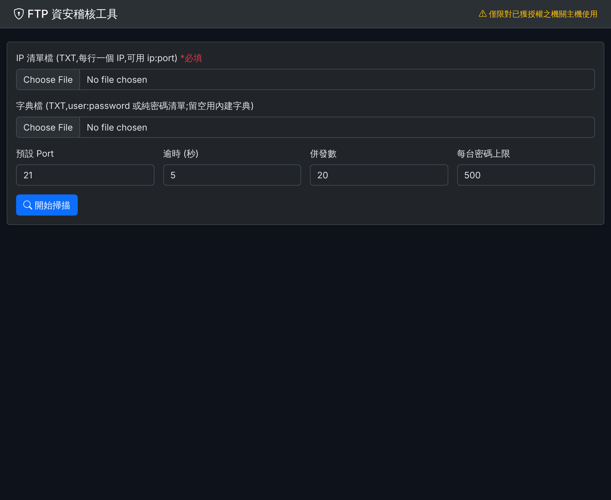
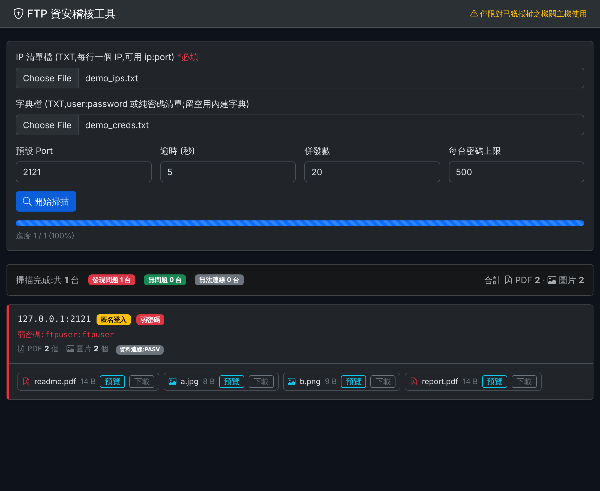
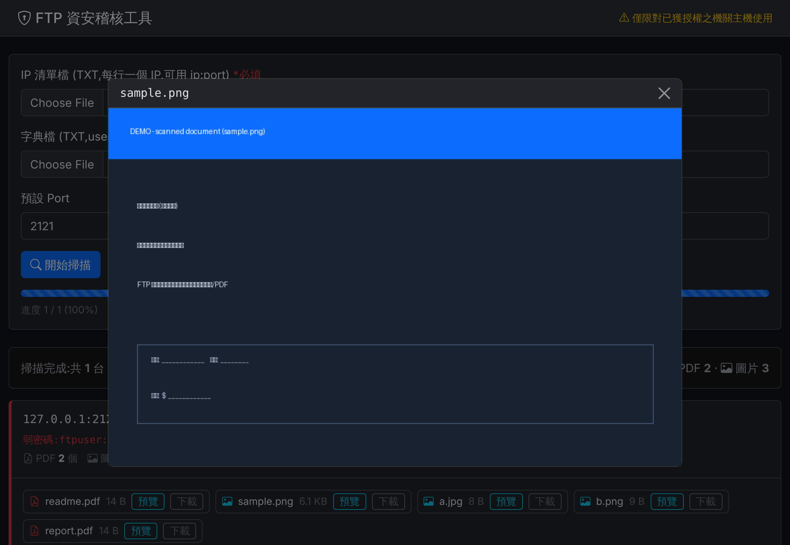
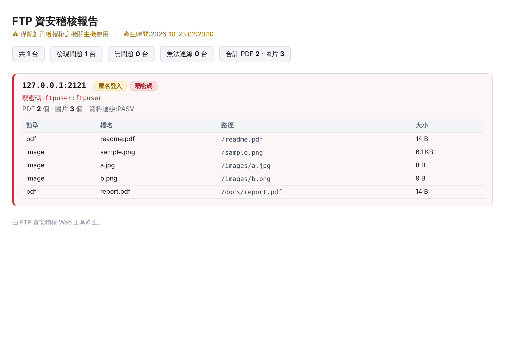

# FTP 資安稽核 Web 工具

針對機關內網 FTP 伺服器進行**匿名登入 / 弱密碼**檢測的網頁工具。
登入成功後會遞迴掃描目錄,統計 PDF 與圖片檔數量,並可直接於網頁預覽與下載。

介面採用 **Bootstrap 5.3(本機自帶)**,完全不依賴外網 CDN,適合部署於離線內網環境。

> ⚠️ **使用授權聲明**
> 本工具僅限對**自己機關擁有、或已取得書面授權**的主機進行資安稽核。
> 未經授權對他人系統進行密碼嘗試,在多數司法管轄區屬違法行為,使用者須自負法律責任。

---

## 介面預覽

**上傳與參數設定**

上傳 IP 清單與字典檔,設定 Port / 逾時 / 併發數後開始掃描:



**掃描結果**

有問題的主機以紅色標示,列出弱密碼、PDF / 圖片數量、採用的資料連線模式,並提供每個檔案的「預覽 / 下載」:



**網頁預覽檔案**

直接在網頁預覽掃到的圖片與 PDF(彈窗),無須下載:



**匯出的 HTML 報告**

一鍵匯出自成一體的 HTML 報告(離線可開、可列印歸檔):



---

## 一、功能

| 功能 | 說明 |
|------|------|
| 匿名登入檢測 | 測試 `anonymous` / `ftp` 是否可免密碼登入 |
| 弱密碼檢測 | 以上傳字典或內建字典嘗試常見帳密 |
| 檔案清點 | 登入成功後遞迴掃描目錄,統計 PDF 與圖片數量 |
| 線上預覽 | 網頁直接預覽掃到的 PDF(內嵌)與圖片 |
| 檔案下載 | 一鍵下載掃到的檔案 |
| 背景掃描 | 多執行緒併發,前端進度條即時顯示,不卡瀏覽器 |
| CIDR 展開 | IP 清單可寫網段(如 `192.168.1.0/24`),自動展開成整段主機 |
| 報告匯出 | 掃描完成一鍵匯出 **CSV**(可進 Excel)與 **HTML**(自成一體、離線可開) |
| 中文檔名 | 自動還原 Big5 / UTF-8 檔名,正確顯示中文 |
| 廣泛相容 | 自動適應不支援 MLSD、不接受帶路徑 LIST、固定被動埠等各種伺服器 |
| 離線可用 | 自帶 Bootstrap,內網無外網也能正常顯示 |

---

## 二、系統需求

- Python 3.6 以上(Kali Linux 通常已內建 Python 3)
- Flask 2.0 以上(唯一的外部套件)

---

## 三、資料夾結構

部署時務必維持以下結構,`static/` 需與主程式放在**同一層**:

```
ftp_audit/
├─ docs/                     存放說明文件與截圖
│  └─ screenshots/           存放介面截圖
│     ├─ 01-form.png
│     ├─ 02-results.png
│     ├─ 03-preview.png
│     └─ 04-report.png
├─ static/                   本機自帶的前端資源(勿更動結構)
│  ├─ bootstrap.min.css
│  ├─ bootstrap.bundle.min.js
│  ├─ bootstrap-icons.css
│  └─ fonts/
│     ├─ bootstrap-icons.woff2
│     └─ bootstrap-icons.woff
├─ wordlist/
│  └─ creds.txt              字典檔(常見帳號密碼組合，供弱密碼檢測使用)
├─ ftp_audit_web.py          主程式(Web 介面)
├─ ftp_diag.py               單機診斷腳本(排查某台伺服器的連線問題)
├─ ftp_probe.py              列目錄「配方探測」腳本(測哪種做法可行)
├─ requirements.txt          相依套件清單
└─ README.md                 本文件
```

---

## 四、安裝

### 情況 A:稽核機可連外網

```bash
cd ftp_audit
pip install -r requirements.txt
```

### 情況 B:離線內網(連 PyPI 也不通)

先在**另一台有網路的機器**(同為 Linux、Python 版本相近)下載 wheel:

```bash
pip download flask -d ./wheels
```

把整個 `ftp_audit/` 連同 `wheels/` 資料夾一起帶進內網,於稽核機執行:

```bash
cd ftp_audit
pip install --no-index --find-links ./wheels flask
```

> Kali Linux 多半已預裝 Flask;可先執行 `python3 -c "import flask"` 確認,若無報錯即代表已安裝,可略過本步驟。

---

## 五、啟動

```bash
cd ftp_audit

# 預設:只綁定本機 127.0.0.1:8000(最安全,僅本機可存取)
python3 ftp_audit_web.py

# 對外提供:讓同網段其他機器可連入(請自行評估風險)
python3 ftp_audit_web.py --host 0.0.0.0 --port 8000
```

| 參數 | 預設值 | 說明 |
|------|--------|------|
| `--host` | `127.0.0.1` | Web 服務綁定位址;對外請改 `0.0.0.0` |
| `--port` | `8000` | Web 服務埠 |

啟動後以瀏覽器開啟 `http://<host>:<port>`。

---

## 六、使用步驟

1. **上傳 IP 清單檔(必填)** — TXT,每行一筆,支援單一 IP、`ip:port`、以及 **CIDR 網段**:
   ```
   192.168.1.10
   192.168.1.20:2121
   10.0.0.5
   192.168.1.0/24       ← 自動展開為該網段所有主機(排除網路/廣播位址)
   ```
   > 單一網段最多展開 `MAX_CIDR_HOSTS`(預設 4096)台,超過會截斷並於進度列提示。重複的目標會自動去除。
2. **上傳字典檔(選填)** — TXT,格式二擇一,程式自動判斷:
   - 每行 `帳號:密碼`,例如 `admin:admin123`
   - 每行只有密碼;程式會自動配對常見帳號(admin / root / ftp / ftpuser / user / test / guest)
   - 留空則使用內建小型字典
3. 視需要調整 **預設 Port / 逾時 / 併發數 / 每台密碼上限**。
4. 按 **開始掃描**,等待進度條完成。
5. 檢視結果:有問題的主機會以紅色標示,列出弱密碼、PDF 與圖片數量,並提供每個檔案的「預覽 / 下載」。
6. **匯出報告**:結果列右上角有「**匯出 CSV**」與「**匯出 HTML**」。
   - **CSV**:每個掃到的檔案一列,含主機 / port / 匿名 / 弱密碼 / 計數 / 資料連線模式 / 檔案路徑與大小;附 BOM,Excel 可直接正確開啟中文。
   - **HTML**:自成一體的報告頁(**白底深字、內嵌樣式、不依賴外網**),適合**列印紙本報表**、存檔歸檔;已含列印專用 CSS(確保底色/標記正確印出、主機區塊不被分頁切斷)。

---

## 七、掃描參數說明

| 參數 | 預設 | 說明 |
|------|------|------|
| 預設 Port | 21 | IP 未指定 port 時採用 |
| 逾時 (秒) | 5 | 單次連線逾時;死 IP 較多時可調小加速 |
| 併發數 | 20 | 同時掃描的執行緒數;IP 多時可調高 |
| 每台密碼上限 | 500 | 單台主機最多嘗試的帳密組合;超過會截斷並標示 |

另有程式內常數可調整(位於 `ftp_audit_web.py` 上方):

| 常數 | 預設 | 說明 |
|------|------|------|
| `MAX_DEPTH` | 3 | 目錄遞迴最大深度 |
| `MAX_FILES_PER_HOST` | 1000 | 單台主機最多收集的檔案數 |
| `PREVIEW_MAX_BYTES` | 30 MB | 單檔預覽 / 下載大小上限 |

---

## 八、安全注意事項

- **預設只綁 `127.0.0.1`**。本工具使用 Flask 內建開發伺服器,**沒有身分驗證機制**;若以 `0.0.0.0` 對外開放,任何能連到本機的人都能操作此介面並檢視掃描結果(含掃到的弱密碼)。正式作業請搭配防火牆限制來源 IP,或僅於跳板機本機操作。
- 掃描結果(含密碼)僅保存在**伺服器記憶體**中,程式重啟即清空;不會寫入磁碟。
- 預覽 / 下載時密碼只留在伺服器端,不會出現在網址列。
- 稽核完成後請關閉服務,避免介面長時間暴露。

---

## 九、常見問題

**Q. 畫面沒有樣式、排版跑掉?**
確認 `static/` 資料夾與 `ftp_audit_web.py` 在同一層且結構完整。瀏覽器開發者工具的 Network 分頁可檢查 `/static/...` 是否為 HTTP 200。

**Q. 某些主機顯示「無法連線」?**
代表該 port 未開放或連線逾時,程式會自動跳過、不影響其他主機。死 IP 多時可調小「逾時」秒數。

**Q. 掃到檔案但預覽失敗?**
可能是檔案超過 30 MB 上限,或來源 FTP 連線中斷。可改用「下載」取回,或調高 `PREVIEW_MAX_BYTES`。

**Q. 大字典跑很久?**
密碼組合 = 字典行數 ×(帳號數,純密碼清單時)。可調低「每台密碼上限」,或改用精簡字典。

**Q. 中文檔名顯示成亂碼?**
程式會自動判斷 Big5 / UTF-8 並還原顯示。若仍有個別檔名異常,多為該伺服器使用了其他編碼,不影響 PDF / 圖片的「計數」(以副檔名判斷)與下載。

---

## 十、登入成功但檔案計數為 0 / 無法列出目錄

這幾乎都是 **FTP「資料連線(data channel)」** 的問題,而非帳密或程式邏輯問題。
FTP 的控制連線(21 埠)與傳輸目錄列表/檔案的資料連線是**分開的**,許多內網伺服器、防火牆、NAT 對資料連線有各種限制。本工具已內建多種相容性處理(見第十一節),但仍可能遇到環境層面的阻礙。

**排查步驟:對「單一台」有問題的伺服器執行診斷腳本**

```bash
python3 ftp_diag.py <IP> <帳號> <密碼> [port]
# 例: python3 ftp_diag.py 192.168.1.10 ftpuser ftpuser
```

它只讀目錄、不下載不修改,會印出 FEAT、PWD,以及被動 / 主動 / 控制IP覆寫等各種列目錄方式的原始結果與 PASV 位址分析。據此判斷:

- **被動成功、主動逾時** → 正常,工具會自動用被動模式。
- **被動 426、主動逾時** → 資料通道受阻;多為 NAT / 防火牆。優先確認稽核機的網路位置(見下)。
- **帶路徑 LIST 失敗、不帶路徑成功** → 伺服器只接受列「當前目錄」;工具已改用 `CWD` + 不帶參數指令處理。

**若想進一步測「哪種列目錄做法可行」,用配方探測腳本:**

```bash
python3 ftp_probe.py <IP> <帳號> <密碼> [port]
```

它會用 4 種最小做法各試 3 次並回報成功率,快速找出該伺服器可行的方式。

**環境層面建議(VMware / NAT 情境)**

- 稽核機若為 **VMware 的 Guest 且用 NAT 網卡**,FTP 資料連線常被 VMware NAT 干擾(主動模式逾時、被動模式 426)。最可靠的解法是把網卡改為 **橋接(Bridged)**,讓 Guest 取得實體區網的真實 IP。
- 若環境不允許橋接,可改在**能正常連線的那台機器(如 Host)**上執行本工具(Python + Flask 在 Windows 亦可執行)。

---

## 十一、技術備註

**後端**:Python 標準函式庫 `ftplib` + Flask。

**編碼相容**:FTP 連線 encoding 採 `latin-1`,避免非 UTF-8 檔名造成解碼錯誤;顯示時自動嘗試 `UTF-8` → `Big5/CP950` 還原中文檔名,FTP 指令則一律使用原始位元組路徑以確保下載正確。

**目錄列舉(針對多種伺服器相容性最佳化)**:

- 一律**先 `CWD` 切進目標目錄,再用「不帶參數」的指令**列出 —— 相容於「不接受 `LIST <路徑>`、只接受列當前目錄」的伺服器。
- **以 `LIST` 為優先**,僅在 `LIST` 指令本身不被支援時才退回 `MLSD` / `NLST`。原因:部分伺服器(固定被動埠)有「**在 `LIST` 之前只要先開過任何資料連線,下一次 `LIST` 就會 426**」的特性,而 `ftplib` 的 `MLSD` 會「先開資料連線才收到不支援」,故不可搶先嘗試。
- `LIST` 解析同時支援 Unix(`ls -l`,含欄位數不同的變體)與 MS-DOS / IIS 兩種格式。

**資料連線模式**:依序嘗試**被動 PASV → 被動 + 控制連線 IP 覆寫 → 主動 PORT**,自動選用可行者;被動模式含重試,單一目錄失敗不影響整體,且每個目錄以獨立連線列出以耐受 flaky 的固定被動埠。

**前端**:Bootstrap 5.3.3 + Bootstrap Icons 1.11.3(本機自帶,離線可用)。
